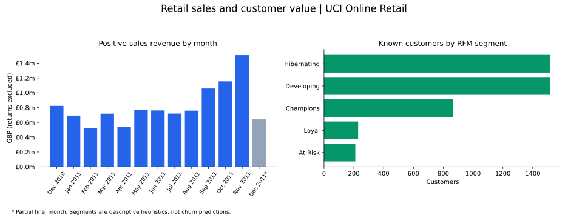

# Retail Sales & Customer Value Analytics

A business-intelligence case study that converts transaction-level retail data into a clean reporting model for revenue, order quality, customer value, product performance, and geographic trends.



## Verified pipeline snapshot

A full run on the official UCI workbook produces **530,104 valid sales lines**, **19,960 distinct invoices**, and **4,338 known customers**. Positive-sales revenue is **£10,666,684.54** before any deduction for returns. Records cover 1 December 2010 through 9 December 2011; the final month is partial and is marked in the preview.

These figures describe this pipeline's documented exclusions, not the retailer's audited net revenue. The preview is generated from the reporting tables, not a mock dashboard.

## Business questions

- How are net revenue, order volume, units sold, and average order value changing over time?
- Which customers contribute the greatest value based on recency, frequency, and monetary value?
- Which products and countries drive revenue, volume, cancellations, and returns?
- Are changes caused by more customers, larger baskets, or pricing?
- Which customer segments should receive retention, reactivation, or high-value service campaigns?

## Data source

This project uses the [Online Retail dataset from the UCI Machine Learning Repository](https://archive.ics.uci.edu/dataset/352/online+retail). It contains 541,909 transactions from a UK-based non-store retailer between December 2010 and December 2011.

Raw data is downloaded from UCI at runtime and is not committed to this repository.

## Deliverables

- validated and cleaned transaction fact table;
- monthly KPI table;
- product and country performance tables;
- customer-level RFM segmentation;
- Power BI star-schema design and DAX measures;
- refreshable Python pipeline and automated tests;
- documented assumptions, exclusions, and data-quality checks.

## Repository structure

| Path | Purpose |
|---|---|
| `src/download_data.py` | Download and extract the official UCI workbook |
| `src/build_model.py` | Validate, clean, and build reporting tables |
| `powerbi/measures.dax` | Core measures for the Power BI semantic model |
| `docs/DATA_MODEL.md` | Fact, dimension, relationship, and grain definitions |
| `docs/KPI_DEFINITIONS.md` | Business rules for every reported KPI |
| `tests/` | Unit tests for cleaning and KPI logic |
| `data/processed/` | Generated reporting tables; not versioned |
| `artifacts/` | Generated visuals and summaries; not versioned |

## Quick start

```bash
python -m venv .venv
source .venv/bin/activate
pip install -r requirements.txt

python src/download_data.py
python src/build_model.py
python -m pytest -q
```

On Windows PowerShell, activate the environment with `.venv\Scripts\Activate.ps1`.

To run `notebooks/key_visuals.ipynb`, install `pip install -r requirements-visuals.txt` in your notebook environment after building the reporting tables. Start the notebook with `notebooks/` as its working directory.

To regenerate the committed preview after building the model:

```bash
pip install -r requirements-visuals.txt
python src/render_preview.py
```

Tests use local fixtures and run without downloading the workbook. Start with [KPI definitions](docs/KPI_DEFINITIONS.md) to understand exclusions, RFM scoring and reporting denominators. The legacy `NetRevenue` field and `[Net Revenue]` measure represent positive-sales revenue; they do not deduct returns.

## Dashboard design

The repository provides reporting tables, model specifications and DAX definitions. The following pages are a report design; a finished `.pbix` dashboard is not included.

1. **Executive overview** — net revenue, orders, customers, units, average order value, and monthly trend.
2. **Customer value** — RFM segments, repeat-customer rate, revenue concentration, and reactivation candidates.
3. **Product performance** — revenue, units, average selling price, cancellation rate, and product ranking.
4. **Geographic performance** — country revenue, customers, orders, basket value, and growth.
5. **Data quality** — excluded records, missing customers, cancellations, negative quantities, and refresh status.

## Responsible interpretation

The dataset represents one retailer and one historical period. Customer identifiers are incomplete for some transactions, product descriptions are operational rather than standardized catalogue labels, and cancellation codes require explicit treatment. Findings demonstrate analytical workflow design and should not be generalized to the wider retail market.
