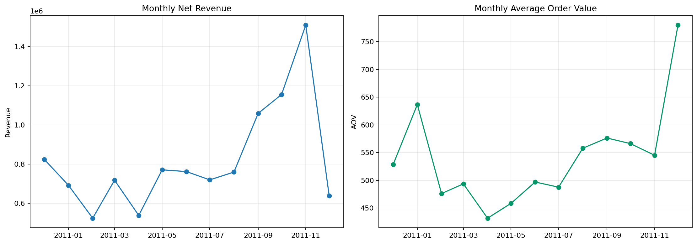
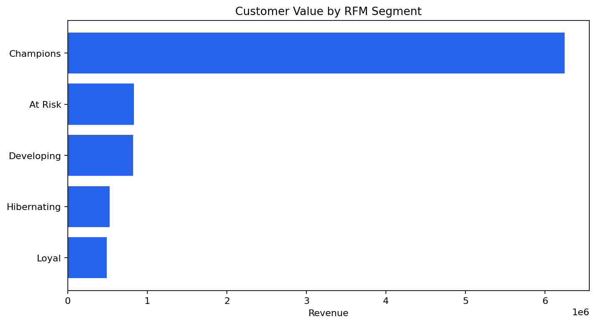
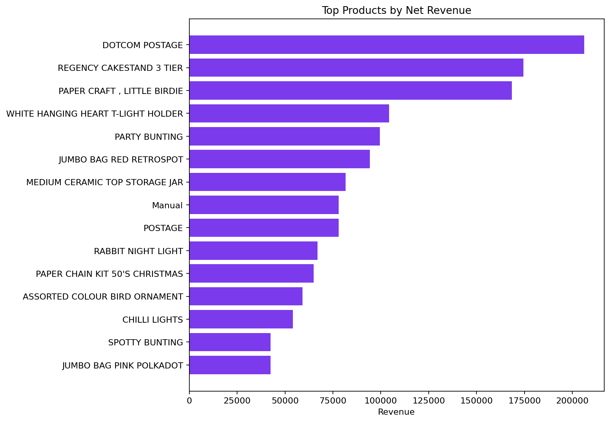

# Retail Sales and Customer Value

**Author:** Mohammed Adeen Shaik  
**Review date:** 11 October 2026

## Research question

How do revenue, basket value and customer contribution vary across this historical retail sample?

## Data and provenance

UCI Online Retail transactions from December 2010 to December 2011.

Source materials are linked from the repository README. Input fingerprints are recorded in [the evidence manifest](evidence.json) so a reader can identify the exact committed artifacts used in this review.

## Method and analytical rationale

Validated transaction rows are aggregated to monthly KPIs, products and countries. RFM groups summarize how recently and frequently customers purchased and how much they spent.

## Findings and interpretation

Fresh pipeline execution on 11 October 2026. The **13 monthly reporting buckets** contain aggregate net revenue of **10,666,684.54 GBP**. The customer RFM table contains **4,338 identified customers**. These totals follow the cleaning and return rules in src/build_model.py. The first and last buckets are incomplete calendar months and should not be used as comparable growth endpoints.

| Measure | Value |
|---|---:|
| monthly buckets | 13 |
| net revenue GBP | 10666684.5440 |
| identified RFM customers | 4338 |

## Limitations

Partial months distort month-to-month comparisons. RFM labels are descriptive rules, not experimentally validated marketing segments. Returns and unidentified customers require explicit treatment.

## Reproduction

Use the setup commands and input contract in the [repository README](https://github.com/Adeen1607/retail-sales-customer-value#readme). Open the [notebook catalogue](notebooks.html) for annotated code and saved outputs. Keep raw records and model binaries local; public reports contain aggregate results or source-embedded figures.

## Final visual results

*Figure from key_visuals.ipynb, original code cell 3.*

*Figure from key_visuals.ipynb, original code cell 4.*

*Figure from key_visuals.ipynb, original code cell 5.*

